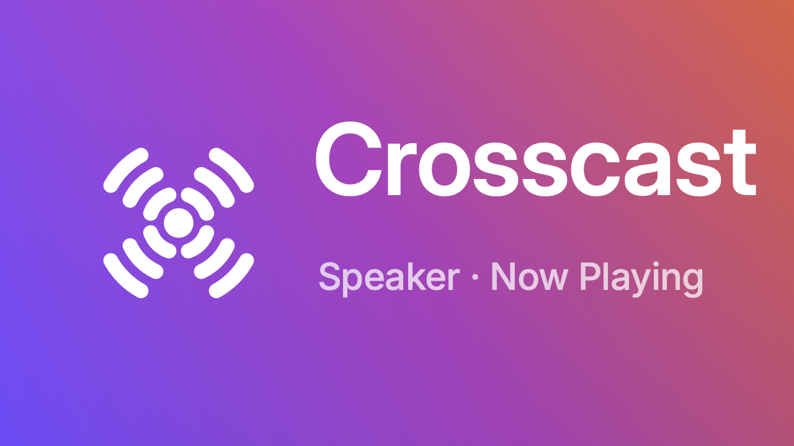
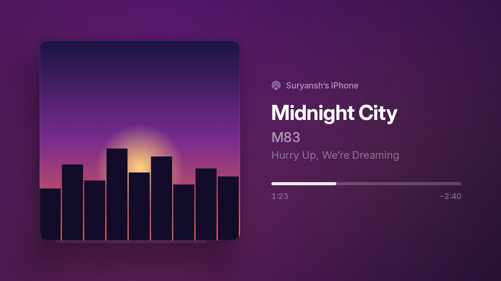
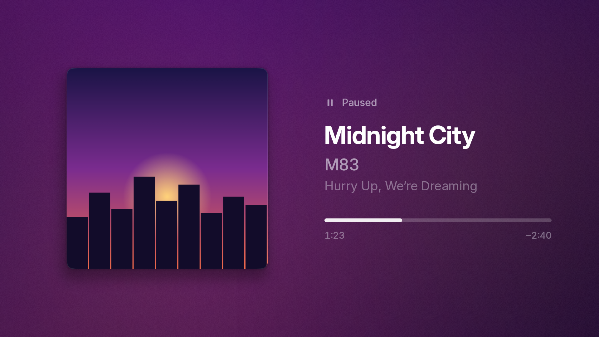
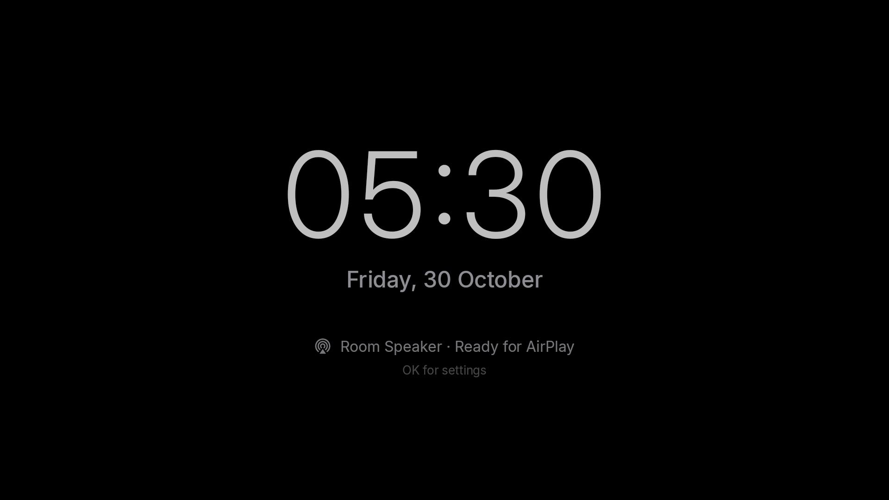
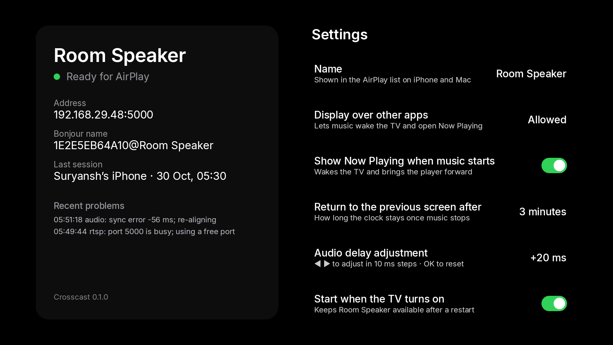

<p align="center"></p>

**Crosscast** turns a Google TV or Android TV, such as a Chromecast with Google TV, into an always-on AirPlay speaker for your iPhone, with a full-screen Now Playing display.

- Pick the TV in the AirPlay menu on your iPhone, iPad or Mac, and the music plays through the TV's speakers.
- If the TV is asleep, it wakes up and shows the cover art, title and progress.
- Control playback from the iPhone, the Apple Watch or the TV remote.
- After the music stops, the TV goes back to whatever it was showing.

<p align="center">
  
  
  
  
</p>

## Features

- **Always ready.** It starts with the TV, survives reboots and app updates, and heals itself if its server dies.
- **Hi-fi audio.** Apple Lossless decoded bit-exact, kept in sync with the sender's clock (typically within 1 ms), with resend of lost packets.
- **Now Playing.**
  - artwork with Apple-style continuous corners, on a slowly moving background made from the cover's colours
  - title, artist, album and live progress, with the sender's name
- **Pause that looks paused.** The progress bar stops and the artwork settles back, like Apple Music.
- **Remote control.**
  - The TV remote's OK, ◀ and ▶ control the iPhone.
  - Volume from the iPhone or Watch shows on screen.
- **Remembers your volume.** iOS starts every classic-AirPlay session at a third of the slider. Crosscast plays at the level you last listened at instead, and the slider still spans its full range, quietest to loudest.
- **Kind to the panel.** A dim clock when idle, and a slow pixel shift against burn-in.

## Requirements

- Google TV or Android TV running Android 12 (API 31) or newer. Tested on a Chromecast with Google TV 4K (Android TV 14); other TVs should work but haven't been tried.
- An iPhone, iPad or Mac on the same Wi-Fi network.

## Install

1. **Get the APK onto the TV.** The direct link is always the latest version:

   ```
   https://github.com/suryxnshsingh/crosscast/releases/latest/download/crosscast.apk
   ```

   - **From the TV:** install a sideloading app such as *Downloader* from the Play Store, enter the link, and allow it to install apps when the TV asks.
   - **From a computer:** download the APK, connect with `adb connect <tv-ip>:<port>`, and run `adb install crosscast.apk`.
2. **Open Crosscast** from the TV's apps row.
3. **Allow it to display over other apps.** Press OK on **Open TV Settings**, move to Crosscast in the list and press OK on it, then press Back. The list doesn't start on Crosscast, so check which app is highlighted before pressing OK. This one permission is what lets music wake the TV and open Now Playing.

That's all. From then on it starts by itself, after every reboot as well.

If you skip step 3, music plays only while the TV is awake, and Now Playing doesn't open by itself. You can allow it later from Settings on the idle clock. If your TV has no such settings screen, Crosscast tells you, and you can grant it from a computer instead:

```sh
adb shell appops set dev.suryansh.crosscast SYSTEM_ALERT_WINDOW allow
```

## Use

- **Play:** on the iPhone, pick **Room Speaker** in Control Center → AirPlay, or from the AirPlay button in any music app.
- **Rename:** on the idle clock, press **OK** to open Settings, which also shows the receiver's status and recent problems.

| TV remote | While playing |
|---|---|
| OK / play-pause | Play or pause on the iPhone |
| ◀ / ▶ | Previous / next track |
| Back | Hide Now Playing (the music keeps playing) |
| Menu | Settings |

## Limitations

- **Classic AirPlay audio only** (AirPlay 1, "RAOP"):
  - no AirPlay 2 multi-room or Home app speaker groups
  - no video or screen mirroring
  - one sender at a time; a new one takes over
- **The iPhone's volume slider opens at about a third** on every connection. iOS gives classic receivers no way to set it. Crosscast compensates by playing at your last level.
- **The screen wakes the TV,** because a sleeping Chromecast routes audio to a dummy output instead of HDMI.

## How it works

Everything is Kotlin; there's no native code. The AirPlay engine in [`receiver-core`](receiver-core) is pure Kotlin and unit-tested on the JVM:

| Part | What it does |
|---|---|
| mDNS | Advertises `_raop._tcp` with the record set Shairport Sync uses |
| RTSP | ANNOUNCE / SETUP / RECORD / FLUSH / SET_PARAMETER / TEARDOWN, with the Apple-Challenge |
| Crypto | RSA-OAEP key unwrap, AES-128-CBC audio decryption |
| Audio | ALAC decoding (port of David Hammerton's decoder), jitter buffer, NTP-style clock sync, drift correction by single-frame stuffing |
| Metadata | DMAP track info, artwork, `progress`; position follows the audio actually heard |
| DACP | Remote control back to the iPhone, over raw HTTP so IPv6 link-local addresses work |

[`docs/notes.md`](docs/notes.md) records what real iPhones actually send, which differs from older documentation:
- pause streams silence
- there's no FLUSH on skip
- the device name is in the SDP

[`docs/decision-engine.md`](docs/decision-engine.md) explains why the engine is written from scratch rather than embedding Shairport Sync.

## Build from source

You need JDK 21 and the Android SDK (`local.properties` with `sdk.dir`, or `ANDROID_HOME`).

```sh
./gradlew test                          # unit tests, including a 30-minute sync simulation and an iOS-like end-to-end stream
./gradlew :app:verifyRoborazziDebug     # UI screenshots match app/src/test/screenshots
./gradlew assembleDebug                 # app/build/outputs/apk/debug/app-debug.apk
./gradlew assembleRelease               # signed with keystore.properties if present, otherwise the debug key
```

Debug builds add test hooks: flag files (`files/force_mute`, `files/no_wake`, `files/dump_pcm`) and broadcast commands. Run commands as `adb shell am broadcast -n dev.suryansh.crosscast/.service.DebugCommandReceiver -a dev.suryansh.crosscast.DEBUG --es command <name>`:
- `playpause`, `nextitem`, `previtem`
- `dacp`
- `set_name`
- `latency`
- `kill_server`

[`tools/stream.py`](tools/stream.py) streams a file with metadata and artwork from a computer using [pyatv](https://pyatv.dev). Logs are tagged by subsystem: `adb logcat -s mdns rtsp audio meta ui`.

The logo, launcher icon and TV banner are generated by [`tools/brand`](tools/brand).

## Credits and licence

Crosscast is MIT-licensed; see [`LICENSE`](LICENSE). It builds on:
- **Shairport Sync**, by Mike Brady and contributors, as the reference for the protocol and timing
- **David Hammerton's ALAC decoder**
- the **Inter** typeface

Details are in [`THIRD_PARTY_NOTICES.md`](THIRD_PARTY_NOTICES.md).

Crosscast is an independent project, not affiliated with, endorsed by or sponsored by Apple or Google. AirPlay, Apple Watch, iPad, iPhone and Mac are trademarks of Apple Inc. Android TV, Chromecast and Google TV are trademarks of Google LLC.
